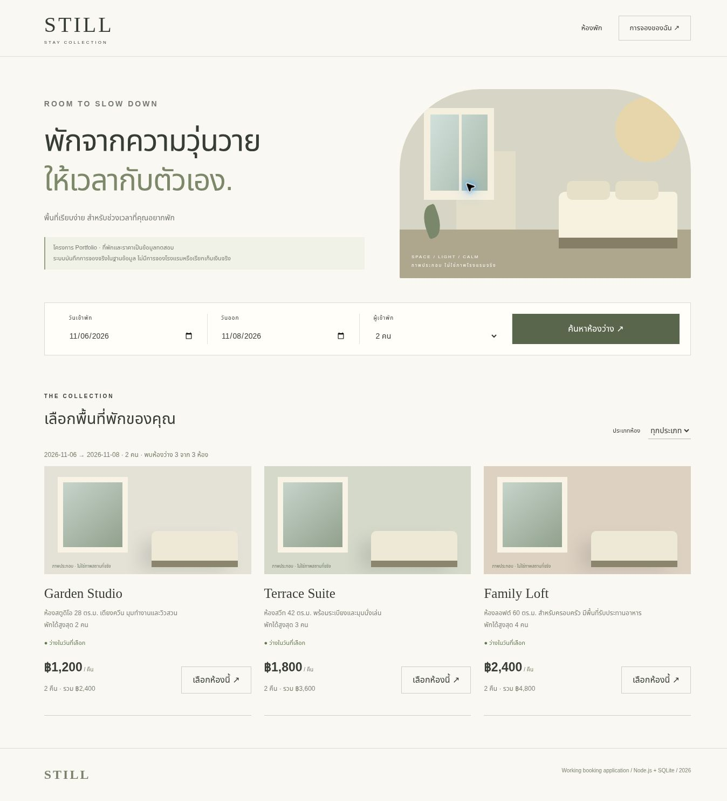
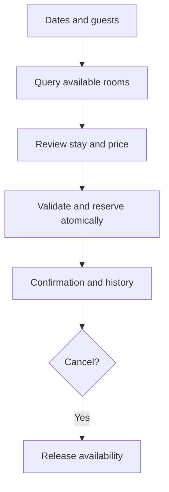

# STILL — Lodging Booking v2

A newly developed, executable booking application (30 October 2026) with a Thai interface, server-validated availability and a persistent SQLite database. Built with AI assistance in ChatGPT Work under Panupong Intasan's direction. Room names, rates and reservations are test data: no actual hotel is booked.



## Run

Requires Node.js 24 or newer. No npm dependencies or separate database installation required.

```bash
npm start
```

Open http://localhost:3000. SQLite is created at `data/stay.sqlite`; override with `DB_FILE` and `PORT` as needed.

```bash
npm test
```

The previous reconstructed PHP/SQL examples remain in `legacy/`. Version 2 deliberately uses Node.js + SQLite; it is not described as a completed PHP/MySQL implementation.

## Implemented

- Date and guest search, room-type filter and live availability from SQLite.
- Nightly rate × number of nights calculated by the server, ignoring client-provided totals.
- Date validation against Asia/Bangkok today; valid calendar dates, 1–30 nights, room capacity checks.
- Atomic reservation with overlap protection. Check-out is exclusive: another guest may arrive on the same date.
- Anonymous browser-owned booking history; another session cannot cancel your reservation.
- Cancellation releases availability and remains in history. Records persist after page reload.

## Flow and model



Tables: `rooms` → `bookings` ← `sessions`. Conflict rule: existing.checkin < requested.checkout AND existing.checkout > requested.checkin, for confirmed records only.

## Actual browser evidence

| File | Observed result |
|---|---|
| [Search](evidence/01-search.jpg) | 3 rooms available for 6–8 November 2026, 2 guests |
| [Confirmation](evidence/02-confirmed.jpg) | Garden Studio booked for 2 nights, THB 2,400 |
| [Persisted booking](evidence/03-persisted-booking.jpg) | After reload, room unavailable and confirmation visible in history |
| [API test output](evidence/api-tests.txt) | 4 suites passed covering overlap, boundaries, ownership, validation and cancellation |

Browser cancellation was also exercised: Garden Studio returned to available and history changed to cancelled. Screenshots show the application executing real code and database changes; room illustrations are labeled CSS artwork, not actual hotel photos.

## Limits

Local portfolio application, no external hotel integration, payment, account login, staff admin or public deployment. Anonymous session cookies have no cross-device recovery; sessions do not expire automatically. No rate limiting or spam prevention for unattended public use. Desktop browser workflow exercised; mobile and complete accessibility verification remain outstanding. Never use real guest information in this version.

See [source provenance](SOURCE_STATUS.md) and [acceptance checks](ACCEPTANCE.md).
