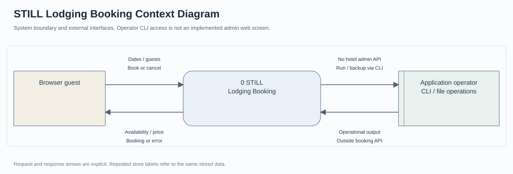
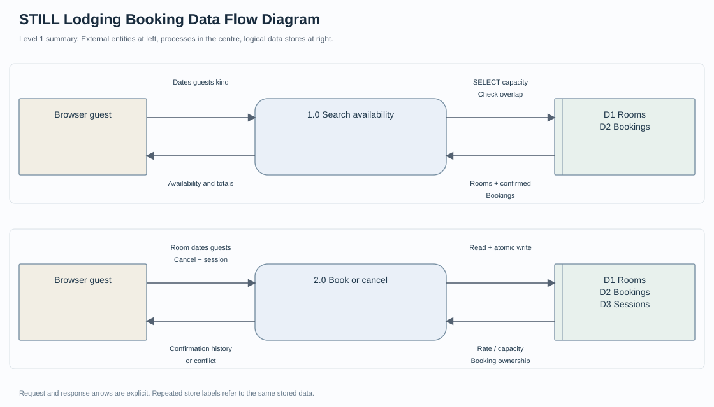
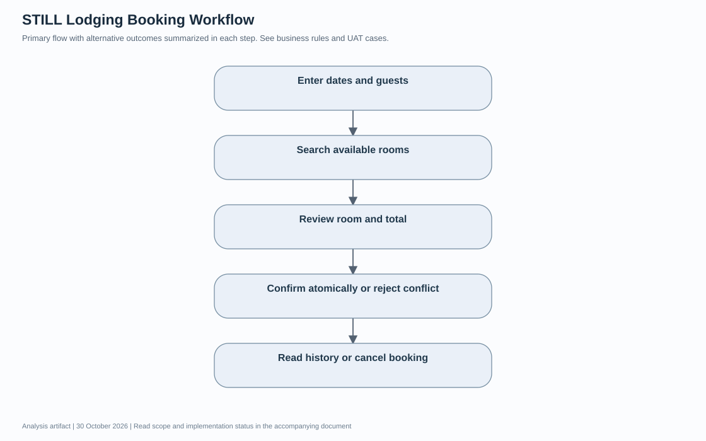
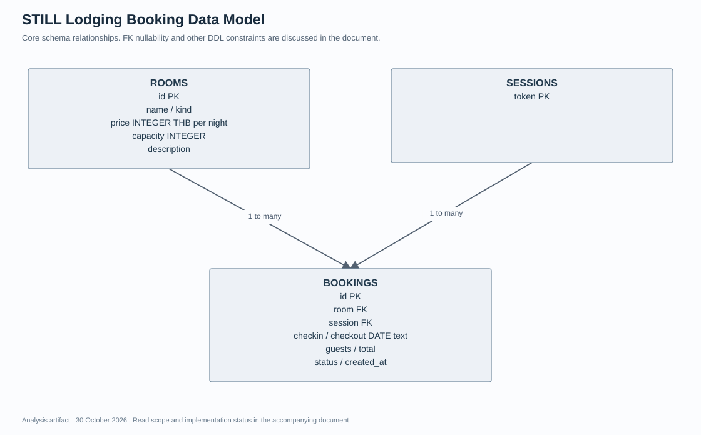

# STILL Lodging Booking เอกสารวิเคราะห์ความต้องการและออกแบบระบบ

รุ่นเอกสาร 1.0 · วันที่ 30 October 2026 · ผู้จัดทำ Panupong Intasan โดยใช้ AI assistance ใน ChatGPT Work

ให้ผู้ใช้ค้นหาห้องตามวันและจำนวนคน ตรวจยอดรวม และจองโดยไม่เกิดช่วงวันที่ทับซ้อน ฐานข้อมูลเก็บรายการและประวัติยกเลิกจริง แต่ห้องและราคาเป็นข้อมูลทดสอบ ไม่ได้จองโรงแรมภายนอก

**สถานะเอกสาร:** จัดทำใหม่จากการอ่านโค้ด ณ commit `3f169eece63f9a70260132736e87aa0a04db773e` เพื่ออธิบายระบบและใช้ตรวจรับ ไม่ใช่บันทึกการสัมภาษณ์หรือหลักฐานว่าผู้มีส่วนได้ส่วนเสียอนุมัติ Requirement แล้ว รายการที่ยังต้องตัดสินใจอยู่ในหัวข้อคำถามยืนยัน

[อ่านฉบับเว็บบน Portfolio](https://intasan.github.io/portfolio/analysis/booking/index.html) · [ไฟล์ HTML](analysis.html) · [Diagram source](diagrams/)

## 1 เป้าหมาย ผู้ใช้งาน และขอบเขต

| ผู้เกี่ยวข้อง | หน้าที่ |
| --- | --- |
| ผู้จองในเบราว์เซอร์ | ค้นหา ตรวจสอบ ยืนยัน ดูประวัติและยกเลิกการจองของตน |
| ผู้ดูแลโครงการ | เตรียมห้องในฐานข้อมูล รันระบบและชุดทดสอบ ไม่มีหน้า Hotel Admin |

**อยู่ในขอบเขต:** ค้นหาห้อง ตรวจ capacity ตรวจช่วงวันที่ คำนวณราคา จองและยกเลิกตาม session

**อยู่นอกขอบเขต:** รับชำระเงิน โรงแรมจริง อีเมลยืนยัน บัญชีสมาชิก การแก้วันจอง และระบบจัดการหลายสาขา

## 2 วิธีเก็บและยืนยันความต้องการ

เอกสารรอบนี้ใช้ source review, schema review และผลทดสอบที่มีอยู่เป็น input ข้อกำหนดแบบ As implemented ใช้อธิบายพฤติกรรมที่พบในโค้ด ส่วน To be เป็นข้อเสนอหรือคำถามที่ยังไม่ได้อนุมัติ ไม่มีการสร้างชื่อผู้ให้สัมภาษณ์ วันประชุม หรือผลลงนามย้อนหลัง

กระบวนการยืนยันที่เสนอคือให้ผู้ใช้งานหลักทบทวน scope และ Business Rules จากนั้นเดินผ่าน scenario ปกติและข้อผิดพลาด บันทึกคำตอบพร้อมผู้ตัดสินใจ แล้วปรับ version ของ Requirement และ UAT ก่อนรับรองการใช้งานจริง

## 3 Functional Requirements และเกณฑ์ยอมรับ

ทุกแถวต่อไปนี้เป็น **As implemented จากโค้ด** คอลัมน์หลักฐานแยกสิ่งที่มีการทดสอบเดิมกับสิ่งที่เพียงพบใน source การจัดทำเอกสารไม่ได้ทำให้ผลทดสอบที่ยังรออยู่กลายเป็นผ่าน

| รหัส | ความต้องการ | เกณฑ์ยอมรับ | Source | หลักฐานหรือสถานะ |
| --- | --- | --- | --- | --- |
| B-FR01 | ค้นหาตามวันและจำนวนคน | GET /api/rooms กรอง capacity และคืน available ของแต่ละห้อง | server.js | tests/booking.test.js / browser เดิม |
| B-FR02 | กรองประเภทห้อง | คืนเฉพาะ studio suite หรือ family ตาม kind ที่เลือก | server.js | พบในโค้ด ยังไม่มีผลทดสอบเฉพาะ |
| B-FR03 | ตรวจวันเข้าพักและวันออก | วันที่ปฏิทินถูกต้อง วันเข้าไม่เป็นอดีตตาม Asia/Bangkok วันออกหลังวันเข้า ไม่เกิน 30 คืน | server.js | tests/booking.test.js |
| B-FR04 | ตรวจความจุห้อง | guests เป็นจำนวนเต็มบวกและไม่เกิน capacity ของห้อง | server.js | tests/booking.test.js |
| B-FR05 | คำนวณราคาที่เซิร์ฟเวอร์ | total = room.price × nights ไม่ใช้ total จาก client | server.js | tests/booking.test.js |
| B-FR06 | กันจองซ้อนแบบ atomic | ตรวจ overlap และ INSERT ภายใน BEGIN IMMEDIATE เดียวกัน | server.js | tests/booking.test.js |
| B-FR07 | ยืนยันจองและสร้างรหัส | สร้าง UUID สถานะ confirmed พร้อมเวลา created_at | server.js | browser เดิม |
| B-FR08 | คืนประวัติของ session เท่านั้น | GET /api/bookings JOIN ชื่อห้อง และไม่ส่ง token session กลับ | server.js | tests/booking.test.js |
| B-FR09 | ยกเลิกเฉพาะรายการของตน | confirmed → cancelled เท่านั้น ห้องกลับมาว่างตามช่วงวันเดิม | server.js | tests/booking.test.js / browser เดิม |
| B-FR10 | แสดงข้อความเมื่อเกิด conflict | หากห้องถูกจองแล้วให้ API ตอบ 409 และ UI แสดงเหตุผล | server.js | tests/booking.test.js เฉพาะ API |

## 4 Business Rules

1. ช่วงเข้าพักใช้ [checkin, checkout) จึงให้ลูกค้ารายใหม่เข้าวันที่อีกรายออกได้
2. เงื่อนไขซ้อน: existing.checkin < requested.checkout AND existing.checkout > requested.checkin เฉพาะ status confirmed
3. หนึ่ง room record หมายถึงห้องที่จองได้หนึ่งหน่วย ไม่ใช่ room type ที่มีหลายห้องให้กระจาย
4. created_at เป็น timestamp แต่ checkin และ checkout เป็นวันที่ ไม่ใช่เวลาเช็คอินตามนาฬิกา
5. รุ่นนี้ยังอนุญาต cancellation โดยไม่มีกฎค่าปรับหรือวันตัดสิทธิ์

## 5 Non Functional Requirements

| รหัส | ประเด็น | เกณฑ์และสถานะ |
| --- | --- | --- |
| booking-NFR01 | Data integrity | ใช้การตรวจสอบ input และการบันทึกที่สอดคล้องกับ business rules; ดูข้อจำกัดรายโครงการด้านล่าง |
| booking-NFR02 | Access control | ตรวจสิทธิ์ที่ server ตาม actor และ endpoint; ไม่อ้างสิทธิ์ที่ระบบยังไม่มี |
| booking-NFR03 | Observability | ต้องอธิบาย error / unavailable และ provenance ที่มีอยู่; audit trail แบบสมบูรณ์ยังไม่ถือว่ามี |
| booking-NFR04 | Usability | เสนอให้ทดสอบ desktop และ mobile ตั้งแต่ 360 px พร้อม keyboard; ยังไม่มีผลตรวจครบทุกขนาด |
| booking-NFR05 | Performance | ยังไม่มี SLA ที่ผู้เกี่ยวข้องอนุมัติ ต้องกำหนดจำนวนผู้ใช้และเกณฑ์ response time ก่อน load test |
| booking-NFR06 | Recovery | เสนอให้ทดสอบสำรองและกู้คืนข้อมูลพร้อมไฟล์ที่สัมพันธ์กัน; RPO/RTO ยังต้องตกลง ไม่กำหนดตัวเลขแทนผู้ใช้ |

## 6 Context Diagram

อ่านร่วมกับ [Mermaid context source](diagrams/context.mmd) ซึ่งแสดงข้อมูลขาเข้าและขาออกแยกทิศทาง Context Diagram กำหนดขอบเขตระบบทั้งก้อน ไม่แสดง data store ภายใน

## 7 Data Flow Diagram และทะเบียนข้อมูล

ภาพ SVG เป็น process overview แบบย่อ ส่วน [DFD Mermaid source](diagrams/data-flow.mmd) และทะเบียนด้านล่างแสดงทิศทาง request/response และ data store อย่างละเอียด ห้ามตีความลูกศรเป็นลำดับเวลาดำเนินงานอย่างเดียว

| Flow | ต้นทาง | ปลายทาง | ข้อมูลที่ส่งไป | ข้อมูลตอบกลับ |
| --- | --- | --- | --- | --- |
| D01 | ผู้จอง | 1.0 Search | checkin checkout guests kind | รายการห้อง available nights total |
| D02 | 1.0 Search | D1 Rooms + D2 Bookings | อ่าน capacity ราคา และ confirmed overlaps | ห้องและรายการที่ทับช่วงวัน |
| D03 | ผู้จอง | 2.0 Booking | room id วันที่และจำนวนคน | booking confirmed หรือ 400/409 |
| D04 | 2.0 Booking | D2 Bookings Sessions | ตรวจเจ้าของและเขียน/ยกเลิก | id status และประวัติ |
| D05 | ผู้จอง | 2.0 Booking | คำขอประวัติหรือยกเลิกพร้อม cookie | ประวัติตนเอง หรือผลยกเลิก |

## 8 Workflow

1. ระบุวันและจำนวนคน
2. ค้นหาห้องว่าง
3. ตรวจห้องและยอดรวม
4. ยืนยันแบบ atomic หรือปฏิเสธ conflict
5. ดูประวัติ หรือยกเลิกคืนห้องว่าง

ข้อผิดพลาดต้องส่งผลตาม Requirement ที่เกี่ยวข้องและไม่ข้ามการตรวจสิทธิ์หรือความถูกต้องของข้อมูล [แก้ไข Mermaid workflow](diagrams/workflow.mmd)

## 9 Data Model และ Data Dictionary

แบบจำลองแสดง core entities ตาม schema ที่ตรวจอ่าน ความสัมพันธ์ที่แอปคาดหวังอาจเข้มกว่าข้อจำกัด nullable ของฐานข้อมูล จึงต้องอ่าน DDL และ validation ประกอบ

| Entity หรือ data store | ข้อมูลหลัก |
| --- | --- |
| ROOMS | id PK; name / kind; price INTEGER THB per night; capacity INTEGER; description |
| SESSIONS | token PK |
| BOOKINGS | id PK; room FK; session FK; checkin / checkout DATE text; guests / total; status / created_at |

| Parent | Child | Relationship |
| --- | --- | --- |
| ROOMS | BOOKINGS | 1 to many |
| SESSIONS | BOOKINGS | 1 to many |

[Mermaid data model source](diagrams/data-model.mmd)

## 10 UAT และ Requirement Traceability

ตารางนี้เป็น test design และ mapping กับหลักฐานที่มี การผ่าน unit/API test ไม่เท่ากับผู้ใช้ปลายทางลงนาม UAT

| Test ID | Requirement | ขั้นตอนหรือ input | ผลคาดหวัง | สถานะหลักฐาน |
| --- | --- | --- | --- | --- |
| B-UAT01 | B-FR05 | Garden 2 คืนพร้อม client total ปลอม | ใช้ราคา server รวม 2400 | ผ่าน API เดิม |
| B-UAT02 | B-FR06 | จองช่วงวันตรงกันหรือทับบางส่วน | 409 และไม่เพิ่มรายการ | ผ่าน API เดิม |
| B-UAT03 | B-FR06 | วันเข้าตรงกับวันออกของรายการเดิม | จองได้ | ผ่าน API เดิม |
| B-UAT04 | B-FR03 B-FR04 | วันผิด อดีต เกิน 30 คืน หรือคนเกิน | 400 และไม่มีรายการใหม่ | ผ่าน API เดิม |
| B-UAT05 | B-FR08 B-FR09 | session อื่นยกเลิก booking | 404 รายการเดิมไม่เปลี่ยน | ผ่าน API เดิม |
| B-UAT06 | B-FR09 | ยกเลิกของตน แล้วค้นช่วงเดิม | แสดง cancelled และห้องกลับว่าง | ผ่าน API และ browser เดิม |

**ผู้ตรวจรับ:** ยังไม่กำหนด · **วันที่ตรวจรับกับผู้ใช้:** ยังไม่ดำเนินการในรอบเอกสารนี้ · **ผลลงนาม:** ยังไม่มี

## 11 ข้อจำกัดและความเสี่ยง

- ยังไม่มีบัญชีสมาชิก expiry, rate limiting และกฎธุรกิจยกเลิกสำหรับโรงแรมจริง
- ต้องทดสอบคำขอพร้อมกันหลายโปรเซสและความทนทานเมื่อฐานข้อมูลล็อกก่อนเปิดใช้งานจริง

## 12 คำถามที่ต้องยืนยันก่อนขยายระบบ

1. ผู้ใช้ยกเลิกได้ถึงเวลาใด และต้องคิดค่าปรับหรือไม่
2. จะรองรับหลายห้องใน room type เดียวกันอย่างไร
3. ต้องล็อกห้องระหว่างชำระเงินหรือยืนยันได้ทันทีเหมือนรุ่นปัจจุบัน
4. ต้องมีช่องทางกู้คืนการจองข้ามอุปกรณ์หรือไม่
5. ราคาเปลี่ยนตามฤดูกาล ภาษี และเตียงเสริมคิดอย่างไร

## 13 Source Baseline และประวัติเอกสาร

- [server.js](https://github.com/intasan/lodging-booking-system/blob/3f169eece63f9a70260132736e87aa0a04db773e/server.js)
- [public/app.js](https://github.com/intasan/lodging-booking-system/blob/3f169eece63f9a70260132736e87aa0a04db773e/public/app.js)
- [tests/booking.test.js](https://github.com/intasan/lodging-booking-system/blob/3f169eece63f9a70260132736e87aa0a04db773e/tests/booking.test.js)
- [ACCEPTANCE.md](https://github.com/intasan/lodging-booking-system/blob/3f169eece63f9a70260132736e87aa0a04db773e/ACCEPTANCE.md)
- [evidence/api-tests.txt](https://github.com/intasan/lodging-booking-system/blob/3f169eece63f9a70260132736e87aa0a04db773e/evidence/api-tests.txt)

| Version | วันที่ | รายการเปลี่ยนแปลง |
| --- | --- | --- |
| 1.0 | 30 October 2026 | จัดทำ requirement catalogue, data flow register, diagrams, data dictionary และ UAT traceability จาก source baseline |

เอกสารวิเคราะห์และไดอะแกรมเป็น deliverable ใหม่ ไม่ใช่ภาพหน้าจอหรือหลักฐานผลการทำงานที่ยังไม่ได้ทดสอบ ไม่มีการอ่านหรือแก้ repository ที่ผู้ใช้ระบุให้ยกเว้น
